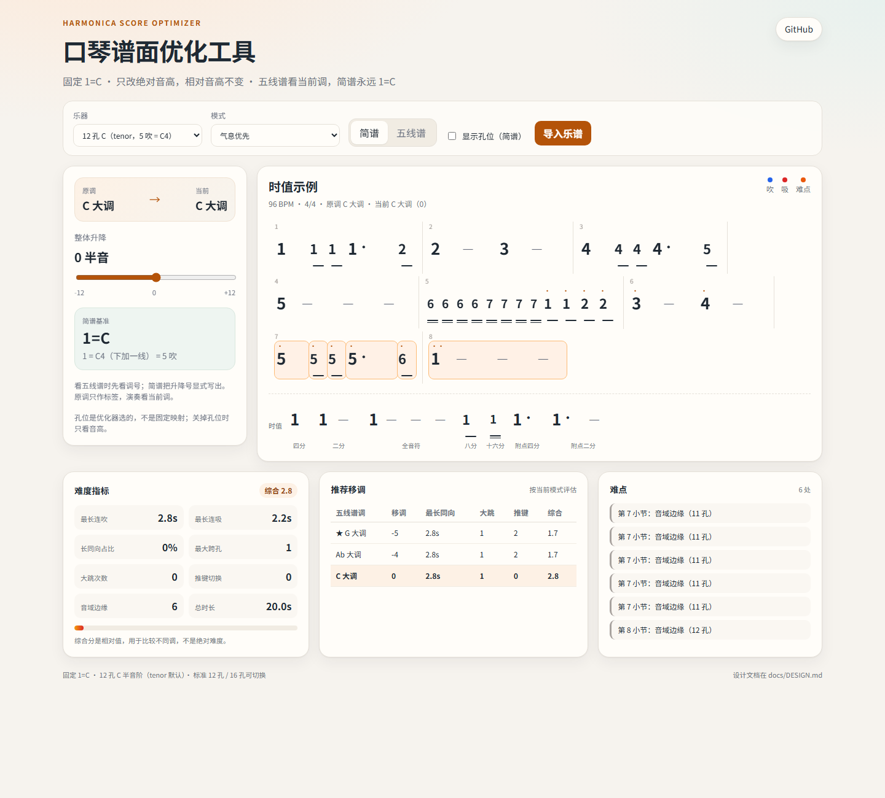

# 口琴谱面优化工具

把一份乐谱，按指定口琴的物理限制和演奏难点，自动或半自动地移调与编排，输出一份“更好吹”的谱子（五线谱 / 简谱）。


> 当前状态：M1 原型 + 输入。已实现简谱 / 五线谱渲染、固定 1=C、整体移调、12/16 孔布局、长同向 / 跨孔优化、指标与推荐调；输入支持内置示例、简谱文本、MusicXML（.xml / .musicxml / .mxl）、印刷体五线谱图片 / PDF（本地 Audiveris OMR）。简谱图片 OCR、音频识别在后续。

## 现在能做什么

- 简谱 / 五线谱一键切换。
- 固定 `1=C`（fixed-do），`1` = C4 = 5 吹 = 下加一线（tenor 12 孔默认）。
- 滑块整体升降，所有相对音高不变；五线谱显示当前调，简谱数字随移调变。
- 12 孔 tenor / 12 孔标准 / 16 孔切换。
- 优化目标：优先避免长连吹 / 长连吸，其次大跨孔；推键低权重。
- 模式：气息优先 / 跳孔优先 / 新手·怕交替 / 推键敏感。
- 指标、难点、推荐移调；孔位可显隐。
- 时值：长音增时线、短音减时线、附点、休止符。
- 导入：简谱文本、MusicXML、五线谱图片 / PDF（本地 OMR）。

## 导入


点击工具栏的「导入乐谱」，有三个入口：

- **简谱文本**：直接编辑 / 粘贴，可选原调、调式、速度、拍号。
- **MusicXML**：.xml / .musicxml / .mxl，取第一个 part 的最高音旋律。
- **图片 OMR**：印刷体五线谱图片 / PDF，走本地 Audiveris 服务。

## 时值显示



| 时值 | 简谱写法 | 说明 |
|---|---|---|
| 四分 | `1` | 一拍 |
| 二分 | `1 —` | 数字后一条增时线 |
| 全音符 | `1 — — —` | 三条增时线 |
| 八分 | `1` + 一条减时线 | 数字下一条线 |
| 十六分 | `1` + 两条减时线 | 数字下两条线 |
| 附点四分 | `1·` | 数字后小圆点 |
| 附点二分 | `1· —` | 附点 + 一条增时线 |
| 休止 | `0` | 同样带增时线 / 减时线 |

## 简谱文本语法

- `1`–`7`：音级；`#` / `b` 前缀：升降；`'` / `,` 后缀：高 / 低八度。
- `-`：延长一拍；`_`：八分音符；`__`：十六分音符；`.`：附点；`0`：休止。
- `|`：小节线（只作可读性，实际按拍号自动分小节）。
- 例：`1 1_ 1_ 1. 2_ | 2 - 3 - | 4 4_ 4_ 4. 5_ | 5 - - -`

## 图片导入（五线谱 OMR）

1. 安装 **Audiveris 5.x**。Ubuntu 24.04 可下载 release 中的 `.deb` 后解压（不需要 root）：

   ```bash
   dpkg-deb -x Audiveris-5.11.0-ubuntu24.04-x86_64.deb ~/.local/opt/audiveris-pkg
   mv ~/.local/opt/audiveris-pkg/opt/audiveris ~/.local/opt/audiveris
   ```

   下载页：<https://github.com/Audiveris/audiveris/releases>。如果 WSL 里下载 release 卡住，可以用 Windows 浏览器下载，再在 WSL 里解压。

2. 启动本地 OMR 服务：

   ```bash
   npm run omr
   ```

   默认监听 `http://localhost:8001`。Audiveris 不在默认路径时：

   ```bash
   AUDIVERIS_BIN=/path/to/Audiveris npm run omr
   ```

3. 在「导入乐谱 → 图片 OMR」上传印刷体五线谱图片 / PDF。

识别内容：调号、拍号、音符、时值。曲名默认用文件名（图片页可手动填写），速度默认 96 BPM。简谱图片 OCR 暂未实现；手写谱、低清照片识别率低。

## 本地运行

```bash
npm install
npm run dev
```

打开 <http://localhost:5173>。

图片导入需要另起 OMR 服务（见上）：

```bash
npm run omr
```

构建：

```bash
npm run build
npm run preview
```

## 简谱约定

- 固定 `1=C`，`1` = C4 = 5 吹 = 下加一线（C3 起始的 tenor 12 孔）。
- `1'` = C5 = 第三间 = 8/9 吹；`1,` = C3 = 1 吹。
- 五线谱的调号决定升降；简谱把升降号显式写出（如 `1#`、`4#`）。
- 标准 C4 起始的 12 孔：整体高一个八度，5 吹 = C5 = 第三间；布局可切换。

## 文档

- [设计文档](docs/DESIGN.md)：需求、乐器模型、优化器、输入输出、里程碑与讨论记录。
